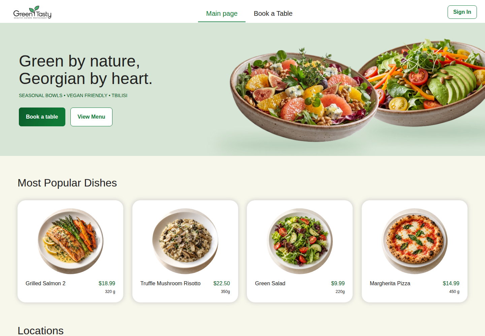

# Green & Tasty — EPAM IT Marathon 2026

**Мова / Language:** [Українською](#українською) · [English](#english)

## Українською

Навчальний проєкт марафону [**EPAM 2026**](https://campus.epam.ua/ua/event/191) на тему ресторанного сервісу **Green & Tasty**: бронювання столиків і спільне попереднє замовлення страв. Моя частина роботи — розгортання застосунку в AWS та реалізація бекенду й фронтенду групового замовлення.

### Мій внесок

#### Виконання домашнього завдання

- **Розгортання:** застосунок працює в AWS; інтерфейс підключено до справжнього API й даних із БД, без моків.
- **Бекенд, рівні 1–3:** отримання учасників та їхніх кошиків, визначення власної сесії власника бронювання, відправлення спільного замовлення ресторану й видалення гостя.
- **Фронтенд, рівні 1–3:** сторінка групового замовлення з картками учасників, стравами, кількістю, сумами та статусами; стани завантаження, помилки й порожнього списку.
- **Спільне замовлення:** об'єднання підтверджених кошиків, підсумовування однакових страв, підтвердження перед відправленням і блокування редагування після нього.
- **Оновлення даних:** автоматично кожні 15 секунд, поки група збирає замовлення, та вручну кнопкою Refresh.
- **Бонус Remove Guest:** видалення гостя разом із його кошиком після підтвердження, з оновленням списку та сум.
- **Перевірки:** автоматичні тести й перевірка на AWS. Мобільний вигляд на ширині 375 px перевірено вручну.
- **AQA, рівні 1–3:** 45 автоматичних UI/API сценаріїв для групового замовлення, окремі тестові дані з прибиранням і успішний запуск у GitHub Actions.

#### Додаткові функціональні розширення та вдосконалення

- **Редагування страв у груповому замовленні:** дороблено API та інтерфейс для зміни кількості й видалення окремих страв із перерахунком усіх сум. Власник може редагувати власний і гостьові кошики, гості — лише свої. У ТЗ ці кнопки прямо виключені з домашки.
- **Меню конкретної локації:** для бронювання показуються лише страви його ресторану, без повторів із меню інших локацій.
- **Власні зображення страв:** згенеровано окремі картинки для набору меню, завантажено їх у S3 та збережено посилання в БД; у груповому замовленні додано картинку-заглушку.
- **Виправлення суміжних сценаріїв:** відображення бронювання на одну людину, перехід із модального вікна саме до попереднього замовлення та помилка створення замовлення з меню.
- **Стабільне редагування кошиків:** картки більше не міняються місцями після кліку, кнопки не зникають під час збереження, а актуальні кількості й суми повертаються після першого запиту. Для додаткових сценаріїв додано тести.

Remove Guest, робота зі справжнім API та оновлення кожні 15 секунд належать до ТЗ, тому наведені в розділі виконаної домашки.

### Використання AI

**OpenAI Codex** використовувався у двох режимах:

- **Окремий AI-асистент** — для спільної роботи над кодом, аналізу та документації.
- **Мультиагентна конфігурація** — з розподілом ролей для оркестрації, реалізації, рев’ю коду та тестування.

### Скріншоти

Знімки розгорнутого застосунку зі справжнім API та окремими тестовими даними.

| Сценарій | Зображення |
| --- | --- |
| Кошики учасників, статуси та сума підтверджених замовлень | [Owner Review](docs/screenshots/01-owner-review.png) |
| Замовлення відправлено ресторану, редагування заблоковано | [Sent to Restaurant](docs/screenshots/02-sent-to-restaurant.png) |
| Підтвердження видалення гостя | [Remove Guest](docs/screenshots/03-remove-guest.png) |
| Зміна кількості страв власника й гостя та перерахунок сум | [Dish Editing](docs/screenshots/04-dish-editing.png) |

### Технології

| Частина | Технології |
| --- | --- |
| Інтерфейс | Angular 22, TypeScript, HTML, SCSS, Signals, RxJS |
| Серверна частина | C#, .NET 10, AWS Lambda, API Gateway |
| Дані та вхід | DynamoDB, Amazon Cognito |
| Зображення та хостинг | Amazon S3, CloudFront |
| Інфраструктура й розгортання | Terraform, AWS Syndicate, AWS CLI |
| Тести | xUnit, Moq, Jasmine, Karma, Chrome Headless; Reqnroll, TUnit, Screenplay, Playwright для .NET |

### Посилання

- [Відкрити застосунок](https://d2hntky491rgpt.cloudfront.net)
- [README_EPAM.md — документація та інструкція розгортання](README_EPAM.md)
- [Завдання з бекенду](homework-backend.md)
- [Завдання з фронтенду](frontend/homework-design/homework-frontend.md) і [пояснення до макетів](frontend/homework-design/README.md)
- [AQA: інструкція для перевіряючого](aqa/restaurant-aqa-framework/docs/reviewer-guide.md) і [завдання](homework-aqa.md)
- [Читати англійською в цьому документі](#english)

---

## English

A learning project for the [**EPAM IT Marathon 2026**](https://campus.epam.ua/ua/event/191), focused on the **Green & Tasty** restaurant service: table reservations and group pre-orders. My work covers AWS deployment and implementation of the group pre-order backend and frontend.

### My contribution

#### Homework implementation

- **Deployment:** the app runs on AWS, with the frontend connected to a real API and database data, without mocks.
- **Backend, levels 1–3:** retrieving participants and their carts, identifying the reservation owner's session, sending the combined order to the restaurant, and removing a guest.
- **Frontend, levels 1–3:** a group order page with participant cards, dishes, quantities, subtotals, and statuses; loading, error, and empty states.
- **Combined order:** merging submitted carts, adding quantities of matching dishes, confirming before sending, and locking editing afterwards.
- **Data refresh:** automatic updates every 15 seconds while the group is collecting pre-orders, plus a manual Refresh button.
- **Remove Guest bonus:** removing a guest and their cart after confirmation, with the participant list and totals updated.
- **Verification:** automated tests and AWS checks. The mobile layout was manually checked at 375 px.
- **AQA, levels 1–3:** 45 automated UI/API examples for group pre-orders, isolated test data with cleanup, and a successful GitHub Actions run.

#### Additional Features and Improvements

- **Group order dish editing:** extended the API and interface to change quantities and remove individual dishes, recalculating all totals. Owners can edit their own and their guests' carts; guests can edit only their own. The assignment explicitly excludes these controls.
- **Location-specific menus:** a reservation shows only dishes from its restaurant, without duplicates from other locations' menus.
- **Custom dish images:** generated individual images for the menu, uploaded them to S3, and stored their URLs in the database; added a placeholder image for group orders.
- **Related flow fixes:** fixed single-person reservations not appearing, made the modal link open the reservation's pre-order menu, and fixed an error when creating an order from the menu.
- **Stable cart editing:** cards keep their positions after a click, controls stay visible while saving, and current quantities and totals are returned after the first request. Added tests for the extra scenarios.

Remove Guest, real API integration, and updates every 15 seconds are part of the assignment and are listed under homework implementation.

### AI Usage

**OpenAI Codex** was used in two modes:

- **Standalone AI assistant** — for collaborative coding, analysis, and documentation.
- **Multi-agent configuration** — with dedicated roles for orchestration, implementation, code review, and testing.

### Screenshots

Captured from the deployed app using the real API and dedicated test data.

| Scenario | Image |
| --- | --- |
| Participant carts, statuses, and the total for submitted carts | [Owner Review](docs/screenshots/01-owner-review.png) |
| Order sent to the restaurant with editing locked | [Sent to Restaurant](docs/screenshots/02-sent-to-restaurant.png) |
| Guest removal confirmation | [Remove Guest](docs/screenshots/03-remove-guest.png) |
| Owner and guest dish quantity changes with recalculated totals | [Dish Editing](docs/screenshots/04-dish-editing.png) |

### Technologies

| Area | Technologies |
| --- | --- |
| Frontend | Angular 22, TypeScript, HTML, SCSS, Signals, RxJS |
| Backend | C#, .NET 10, AWS Lambda, API Gateway |
| Data and authentication | DynamoDB, Amazon Cognito |
| Images and hosting | Amazon S3, CloudFront |
| Infrastructure and deployment | Terraform, AWS Syndicate, AWS CLI |
| Testing | xUnit, Moq, Jasmine, Karma, Chrome Headless; Reqnroll, TUnit, Screenplay, Playwright for .NET |

### Links

- [Open the app](https://d2hntky491rgpt.cloudfront.net)
- [README_EPAM.md — documentation and deployment instructions](README_EPAM.md)
- [Backend assignment](homework-backend.md)
- [Frontend assignment](frontend/homework-design/homework-frontend.md) and [design notes](frontend/homework-design/README.md)
- [AQA reviewer guide](aqa/restaurant-aqa-framework/docs/reviewer-guide.md) and [assignment](homework-aqa.md)
- [Read in Ukrainian in this document](#українською)
