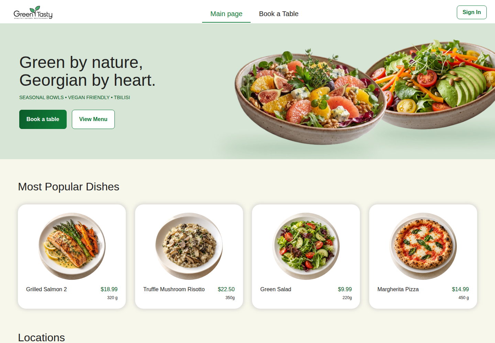

# Green & Tasty — EPAM IT Marathon 2026

**Мова / Language:** [Українською](#українською) · [English](#english)

## Українською

Навчальний проєкт марафону [**EPAM 2026**](https://campus.epam.ua/ua/event/191) на тему ресторанного сервісу **Green & Tasty**. Застосунок дозволяє бронювати столик і заздалегідь замовляти страви разом із гостями. Моя частина роботи — розгортання застосунку в AWS та реалізація бекенду й фронтенду групового попереднього замовлення.

<a href="https://d2hntky491rgpt.cloudfront.net"></a>

### Мій внесок

#### Виконання домашнього завдання

- Виконано три рівні домашнього завдання з бекенду та фронтенду з реальним API й даними з БД.
- Власник бронювання бачить учасників, їхні страви, кількість, суми та статус підтвердження кошиків.
- Підтверджені кошики об'єднуються в одне замовлення для ресторану; однакові страви підсумовуються.
- Сторінка автоматично оновлюється кожні 15 секунд, поки група збирає замовлення; також є ручне оновлення.
- Додано бонус **Remove Guest**: видалення гостя разом із його кошиком після підтвердження дії.
- Після відправлення спільного замовлення редагування блокується.
- Додано автоматичні тести та перевірено зміни на AWS. Мобільний вигляд на ширині 375 px перевірено вручну.

#### Додаткові функціональні розширення та вдосконалення

- **Редагування страв у груповому замовленні:** дороблено API та інтерфейс для зміни кількості й видалення окремих страв із перерахунком усіх сум. Власник може редагувати власний і гостьові кошики, гості — лише свої. У ТЗ ці кнопки прямо виключені з домашки.
- **Меню конкретної локації:** для бронювання показуються лише страви його ресторану, без повторів із меню інших локацій.
- **Власні зображення страв:** згенеровано окремі картинки для набору меню, завантажено їх у S3 та збережено посилання в БД; у груповому замовленні додано картинку-заглушку.
- **Виправлення суміжних сценаріїв:** відображення бронювання на одну людину, перехід із модального вікна саме до попереднього замовлення та помилка створення замовлення з меню.
- **Стабільне редагування кошиків:** картки більше не міняються місцями після кліку, кнопки не зникають під час збереження, а актуальні кількості й суми повертаються після першого запиту. Для додаткових сценаріїв додано тести.

Remove Guest, робота зі справжнім API та оновлення кожні 15 секунд належать до ТЗ, тому наведені в розділі виконаної домашки.

### Використання AI

**OpenAI Codex** використовувався у двох режимах:

- **Окремий AI-асистент** — для спільної роботи над кодом, аналізу та документації.
- **Мультиагентна конфігурація** — з розподілом ролей для оркестрації, реалізації, рев’ю коду та тестування.

### Скріншоти

Знімки розгорнутого застосунку зі справжнім API та окремими тестовими даними.

| Сценарій | Зображення |
| --- | --- |
| Кошики учасників, статуси та сума підтверджених замовлень | [Owner Review](docs/screenshots/01-owner-review.png) |
| Замовлення відправлено ресторану, редагування заблоковано | [Sent to Restaurant](docs/screenshots/02-sent-to-restaurant.png) |
| Підтвердження видалення гостя | [Remove Guest](docs/screenshots/03-remove-guest.png) |
| Зміна кількості страв власника й гостя та перерахунок сум | [Dish Editing](docs/screenshots/04-dish-editing.png) |

### Технології

| Частина | Технології |
| --- | --- |
| Інтерфейс | Angular 22, TypeScript, HTML, SCSS, Signals, RxJS |
| Серверна частина | C#, .NET 10, AWS Lambda, API Gateway |
| Дані та вхід | DynamoDB, Amazon Cognito |
| Зображення та хостинг | Amazon S3, CloudFront |
| Інфраструктура й розгортання | Terraform, AWS Syndicate, AWS CLI |
| Тести | xUnit, Moq, Jasmine, Karma, Chrome Headless |

### Посилання

- [Відкрити застосунок](https://d2hntky491rgpt.cloudfront.net)
- [Завдання з бекенду](homework-backend.md)
- [Завдання з фронтенду](frontend/homework-design/homework-frontend.md) і [пояснення до макетів](frontend/homework-design/README.md)
- [Інструкція розгортання англійською](#deployment-guide)
- [Читати англійською в цьому документі](#english) · [Повернутися до головного README](README.md)

---

## English

A learning project for the [**EPAM IT Marathon 2026**](https://campus.epam.ua/ua/event/191), focused on the **Green & Tasty** restaurant service. The app lets customers book a table and pre-order dishes together with their guests. My work covers AWS deployment and implementation of the group pre-order backend and frontend.

<a href="https://d2hntky491rgpt.cloudfront.net"></a>

### My contribution

#### Homework implementation

- Completed all three backend and frontend homework levels using a real API and database data.
- The reservation owner can see participants, their dishes, quantities, subtotals, and cart submission statuses.
- Submitted carts are combined into one restaurant order, with quantities of matching dishes added together.
- The page refreshes automatically every 15 seconds while the group is collecting pre-orders; manual refresh is also available.
- Added the **Remove Guest** bonus: removing a guest and their cart after a confirmation dialog.
- Editing is locked after the group order is sent.
- Added automated tests and verified the changes on AWS. The mobile layout was manually checked at 375 px.

#### Additional Features and Improvements

- **Group order dish editing:** extended the API and interface to change quantities and remove individual dishes, recalculating all totals. Owners can edit their own and their guests' carts; guests can edit only their own. The assignment explicitly excludes these controls.
- **Location-specific menus:** a reservation shows only dishes from its restaurant, without duplicates from other locations' menus.
- **Custom dish images:** generated individual images for the menu, uploaded them to S3, and stored their URLs in the database; added a placeholder image for group orders.
- **Related flow fixes:** fixed single-person reservations not appearing, made the modal link open the reservation's pre-order menu, and fixed an error when creating an order from the menu.
- **Stable cart editing:** cards keep their positions after a click, controls stay visible while saving, and current quantities and totals are returned after the first request. Added tests for the extra scenarios.

Remove Guest, real API integration, and updates every 15 seconds are part of the assignment and are listed under homework implementation.

### AI Usage

**OpenAI Codex** was used in two modes:

- **Standalone AI assistant** — for collaborative coding, analysis, and documentation.
- **Multi-agent configuration** — with dedicated roles for orchestration, implementation, code review, and testing.

### Screenshots

Captured from the deployed app using the real API and dedicated test data.

| Scenario | Image |
| --- | --- |
| Participant carts, statuses, and the total for submitted carts | [Owner Review](docs/screenshots/01-owner-review.png) |
| Order sent to the restaurant with editing locked | [Sent to Restaurant](docs/screenshots/02-sent-to-restaurant.png) |
| Guest removal confirmation | [Remove Guest](docs/screenshots/03-remove-guest.png) |
| Owner and guest dish quantity changes with recalculated totals | [Dish Editing](docs/screenshots/04-dish-editing.png) |

### Technologies

| Area | Technologies |
| --- | --- |
| Frontend | Angular 22, TypeScript, HTML, SCSS, Signals, RxJS |
| Backend | C#, .NET 10, AWS Lambda, API Gateway |
| Data and authentication | DynamoDB, Amazon Cognito |
| Images and hosting | Amazon S3, CloudFront |
| Infrastructure and deployment | Terraform, AWS Syndicate, AWS CLI |
| Testing | xUnit, Moq, Jasmine, Karma, Chrome Headless |

### Links

- [Open the app](https://d2hntky491rgpt.cloudfront.net)
- [Backend assignment](homework-backend.md)
- [Frontend assignment](frontend/homework-design/homework-frontend.md) and [design notes](frontend/homework-design/README.md)
- [Deployment guide](#deployment-guide)
- [Read in Ukrainian in this document](#українською) · [Back to the main README](README.md)

<a id="deployment-guide"></a>

<details>
<summary>Deployment guide — original instructions</summary>

### Original deployment instructions

This repo uses three deployment tracks:

- Terraform for shared AWS infrastructure under `infra/terraform`
- AWS Syndicate for the backend application under `backend/restaurant-backend-app`
- Angular build artifacts synced to the frontend S3 bucket under `frontend/restaurant-frontend-app`

## Prerequisites

Install the tools below on your machine:

- AWS CLI configured with credentials for the target AWS account (`aws configure`) (https://docs.aws.amazon.com/cli/latest/userguide/getting-started-prereqs.html)
- Terraform 1.10 or newer (https://developer.hashicorp.com/terraform/install)
- Python 3.10-3.11 (https://www.python.org/downloads/release/python-3110/)
- .NET 10 SDK (https://dotnet.microsoft.com/en-us/download/dotnet/10.0)
- AWS Syndicate (`pip install aws-syndicate`) (https://github.com/epam/aws-syndicate)
- Node.js 22.x with npm (https://nodejs.org/en/download/archive/v22.0.0)

## Deployment order

Use this order:

1. Deploy Terraform infrastructure
2. Deploy the backend using Syndicate
3. Deploy the frontend to s3

Terraform then provisions or updates the shared AWS foundation, including the frontend S3 bucket and CloudFront distribution. Syndicate packages and deploys the backend application stack. After that, build the Angular app with the correct backend URL and sync it to S3.

## 1. Deploy Terraform infrastructure

Terraform manages the shared infrastructure resources in `infra/terraform`.

Before deploying, verify terraform config files:
Replace variables with your **AWS account ID** and **Email**

- `infra/terraform/backend.tf` - replace the Terraform state bucket name
- `infra/terraform/variables.tf` - replace the default `account_id` and `alert_emails`


Before running `terraform init`, create the Terraform state bucket with AWS CLI if it does not already exist. 
Get your AWS account ID from the CLI first:

Windows PowerShell:

```powershell
$ACCOUNT_ID = aws sts get-caller-identity --query Account --output text
```

Linux or macOS:

```bash
ACCOUNT_ID=$(aws sts get-caller-identity --query Account --output text)
```

You can use AWS Console interface
AWS Management Console equivalent:
- Go to **S3** → **Create bucket** and use the bucket name **restaurant-terraform-state-$ACCOUNT_ID**
- Turn on **Versioning** in the bucket properties
- Leave **Block all public access** enabled
- Use **Default encryption** with SSE-S3 (AES256)

As alternative you can you AWS CLI
Replace the bucket name with the CLI variable:

Windows PowerShell:

```powershell
aws s3api create-bucket `
	--bucket restaurant-terraform-state-$ACCOUNT_ID `
	--region us-west-2 `
	--create-bucket-configuration LocationConstraint=us-west-2

aws s3api put-bucket-versioning `
	--bucket restaurant-terraform-state-$ACCOUNT_ID `
	--versioning-configuration Status=Enabled

aws s3api put-public-access-block `
		--bucket restaurant-terraform-state-$ACCOUNT_ID `
	--public-access-block-configuration `
		"BlockPublicAcls=true,IgnorePublicAcls=true,BlockPublicPolicy=true,RestrictPublicBuckets=true"
```

Linux or macOS:

```bash
aws s3api create-bucket \
	--bucket restaurant-terraform-state-$ACCOUNT_ID \
	--region us-west-2 \
	--create-bucket-configuration LocationConstraint=us-west-2

aws s3api put-bucket-versioning \
	--bucket restaurant-terraform-state-$ACCOUNT_ID \
	--versioning-configuration Status=Enabled

aws s3api put-public-access-block \
		--bucket restaurant-terraform-state-$ACCOUNT_ID \
	--public-access-block-configuration \
		"BlockPublicAcls=true,IgnorePublicAcls=true,BlockPublicPolicy=true,RestrictPublicBuckets=true"
```

### After bucket creation
```bash
cd ../../infra/terraform
terraform init
terraform fmt -check -recursive
terraform validate
terraform plan
terraform apply -auto-approve
```

## 2. Deploy the backend with Syndicate

The backend app is deployed from `backend/restaurant-backend-app`.

Before deploying, verify the Syndicate config files:
edit syndicate.yml → set project_path to your local absolute path to backend/restaurant-backend-app
Replace bucket names with your AWS account ID
- `.syndicate-config-restaurant-backend-app/syndicate.yml`
- `.syndicate-config-restaurant-backend-app/syndicate_aliases.yml`

On Windows PowerShell, run:

```powershell
cd ../../backend/restaurant-backend-app
python3 -m venv syndicate_venv
.\syndicate_venv\Scripts\Activate.ps1
pip install aws-syndicate
$env:SDCT_CONF = (Resolve-Path ".\.syndicate-config-restaurant-backend-app").Path
syndicate create-deploy-target-bucket
syndicate build
syndicate deploy --deploy_name dev
```

On Linux or macOS, run:

```bash
cd ../../backend/restaurant-backend-app
python3 -m venv syndicate_venv
source syndicate_venv/bin/activate
export SDCT_CONF="$(pwd)/.syndicate-config-restaurant-backend-app"
syndicate create-deploy-target-bucket
syndicate build
syndicate deploy --deploy_name dev
```

For an incremental update instead of a full deploy, run the matching command for your shell.

```
syndicate update
```

## 3. Deploy the frontend

This section describes the manual deployment flow. It does not use GitHub Actions.

Terraform creates and configures everything needed for frontend hosting:

- the private frontend S3 bucket
- the bucket policy that allows CloudFront to read from it
- the CloudFront distribution that serves the site

You do not need to configure the bucket manually after `terraform apply`. The manual part is only building the frontend and uploading the files to S3.

### 3.1 Get the backend URL

Use the deployed API Gateway base URL as `BACKEND_URL`. Example:

```text
https://<api-id>.execute-api.us-west-2.amazonaws.com/develop
```

The production frontend build will fail unless `BACKEND_URL` is set.

To look it up in AWS:

```powershell
aws apigateway get-rest-apis --region us-west-2 --query "items[?name=='restaurant-backend-api'].{name:name,id:id}" --output table
```

Or set variables from AWS CLI:

Windows PowerShell:

```powershell
$API_ID = aws apigateway get-rest-apis --region us-west-2 --query "items[?name=='restaurant-backend-api'].id | [0]" --output text
$env:BACKEND_URL = "https://$API_ID.execute-api.us-west-2.amazonaws.com/develop"
```

Linux or macOS:

```bash
API_ID=$(aws apigateway get-rest-apis --region us-west-2 --query "items[?name=='restaurant-backend-api'].id | [0]" --output text)
export BACKEND_URL="https://$API_ID.execute-api.us-west-2.amazonaws.com/develop"
```

### 3.2 Build the production bundle

From the frontend app directory, install dependencies and build:

```powershell
cd ../../frontend/restaurant-frontend-app
npm ci
npm run build
```

The build process generates `src/environments/environment.production.ts` automatically from `BACKEND_URL` and writes the production bundle to `dist/restaurant-frontend-app/browser`.

### 3.3 Upload the bundle to S3

Sync the built files to the frontend bucket:

```powershell
aws s3 sync dist/restaurant-frontend-app/browser s3://restaurant-frontend-$ACCOUNT_ID/ --delete
```

The `--delete` flag removes files in S3 that no longer exist in the local build output.

### 3.4 Get the frontend URL

Get the CloudFront domain name from Terraform:

```powershell
cd ../../infra/terraform
terraform output cloudfront_distribution_domain_name
terraform output cloudfront_distribution_id
```

Use the returned domain name as the frontend host. Example:

```text
https://dxxxxxxxxxxxx.cloudfront.net
```

CloudFront does not provide a fixed public IP you should use. Use the distribution domain name instead.

## Clean up all resources

Use the reverse order of deployment:

1. Remove uploaded frontend files from the frontend S3 bucket
2. Clean up the backend resources deployed by Syndicate
3. Destroy the shared infrastructure managed by Terraform
4. Remove the Terraform state bucket
5. Remove the Syndicate artifacts bucket

### Remove frontend files from S3

The frontend bucket must be empty before Terraform can destroy it.

```powershell
aws s3 rm s3://restaurant-frontend-$ACCOUNT_ID/ --recursive
```

If you are not using the shared training account, replace the bucket name with your own account-specific frontend bucket.

### Clean up backend resources with Syndicate

From the backend project directory, use the same Syndicate configuration and run:

```powershell
cd ../../backend/restaurant-backend-app
$env:SDCT_CONF = (Resolve-Path ".\.syndicate-config-restaurant-backend-app").Path
syndicate clean
```

On Linux or macOS, use:

```bash
cd ../../backend/restaurant-backend-app
export SDCT_CONF="$(pwd)/.syndicate-config-restaurant-backend-app"
syndicate clean
```

This removes the backend resources that Syndicate deployed into the AWS account.

### Destroy Terraform-managed infrastructure

After the frontend bucket is empty and the backend resources are removed, destroy the shared infrastructure:

```powershell
cd ../../infra/terraform
terraform destroy -auto-approve
```

This removes the frontend S3 bucket, CloudFront distribution, and the rest of the infrastructure managed in `infra/terraform`.

### Clear versioned bucket

S3 bucket for storing terraform state have versioning configured. In order to delete it you must empty all versions created for s3 object.

- Go to **S3** select **restaurant-terraform-state-$ACCOUNT_ID** → **Empty Bucket**

### Remove the Terraform state bucket

The Terraform state bucket is configured in `infra/terraform/backend.tf` and is not deleted by `terraform destroy`. Empty it first and then delete it manually:

```powershell
aws s3api delete-bucket --bucket restaurant-terraform-state-$ACCOUNT_ID --region us-west-2
```

### Remove the Syndicate artifacts bucket

The Syndicate deploy target bucket is not managed by Terraform in this repo. If you also want to delete that bucket, empty it first and then remove it manually:

```powershell
aws s3 rm s3://marathon2026-restaurant-artifacts-$ACCOUNT_ID/ --recursive
aws s3api delete-bucket --bucket marathon2026-restaurant-artifacts-$ACCOUNT_ID --region us-west-2
```

Only do this if you are sure you no longer need the stored Syndicate build artifacts.

</details>
